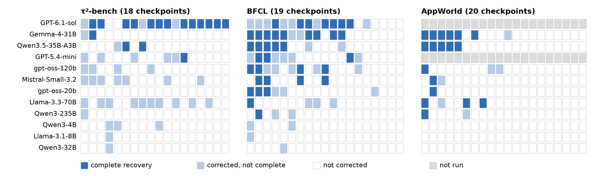

# SecondChance

SecondChance is an error checkpoint dataset and evaluation harness for error recovery in AI agents. Each checkpoint is the saved history
and restorable state right after a natural error that an agent made in its own task attempt in τ²-bench, BFCL or AppWorld. The harness
restores a checkpoint, verifies it, resumes a different agent from the same error under one of four assistance conditions (unaided,
notified, localized, plan-assisted) and scores what it does next: whether it corrects the error, keeps the correction, finishes the task,
respects the policy and protected state, tells the user, and at what cost. Each error also carries what we could establish about fixing
it: a demonstrated fix, a proof that none exists, or unknown.

Paper: <ARXIV_URL> · Dataset: <HF_DATASET_URL> · DOI: <DOI>



*Figure 2 of the paper: with a repair plan, which model corrects (light) or completely recovers from (dark) each of the 57 errors with a
demonstrated fix. An empty cell is a missed fix that is known to exist.*

## Main results (Table 3)

All 129 checkpoints, pooled over the environments each model was run in. C: rate of runs that correct the error; **R**: rate of complete
recoveries; n: runs per condition. U unaided, N notified, L localized, PA plan-assisted.

| Model | n | U: C | U: R | N: C | N: R | L: C | L: R | PA: C | PA: **R** |
|---|---:|---:|---:|---:|---:|---:|---:|---:|---:|
| GPT-6.1-sol | 75 | .21 | .16 | .21 | .15 | .27 | .16 | .43 | **.27** |
| Gemma-4-31B | 128 | .03 | .03 | .04 | .04 | .03 | .03 | .16 | **.12** |
| Qwen3.5-35B-A3B | 128 | .02 | .01 | .05 | .04 | .02 | .02 | .12 | **.09** |
| GPT-5.4-mini | 75 | .00 | .00 | .00 | .00 | .00 | .00 | .19 | **.05** |
| gpt-oss-120b | 129 | .01 | .01 | .02 | .02 | .02 | .02 | .12 | **.04** |
| Mistral-Small-3.2 | 129 | .01 | .00 | .01 | .01 | .01 | .01 | .11 | **.04** |
| gpt-oss-20b | 129 | .00 | .00 | .01 | .01 | .01 | .01 | .05 | **.03** |
| Llama-3.3-70B | 129 | .01 | .01 | .01 | .01 | .01 | .01 | .14 | **.03** |
| Qwen3-235B | 128 | .01 | .01 | .00 | .00 | .00 | .00 | .05 | **.02** |
| Qwen3-4B | 129 | .01 | .01 | .00 | .00 | .00 | .00 | .04 | **.00** |
| Llama-3.1-8B | 129 | .00 | .00 | .01 | .01 | .00 | .00 | .02 | **.00** |
| Qwen3-32B | 129 | .01 | .01 | .00 | .00 | .01 | .01 | .02 | **.00** |
| All models | 1,437 | .02 | .02 | .02 | .02 | .02 | .02 | .11 | **.05** |

## Quickstart

Python 3.12. The quickstart runs a model on ten τ²-bench checkpoints with a demonstrated fix, under all four conditions, and prints its
scorecard.

```bash
# 1. install (tau2-bench is installed from its pinned commit; it is not on PyPI)
git clone <GITHUB_URL> && cd SecondChance
pip install -e ".[tau2]" && secondchance setup tau2

# 2. run a model on the ten-checkpoint quickstart and print its scorecard
#    (any OpenAI-compatible endpoint; the simulated user is gpt-4.1-2025-04-14 as in the paper and needs OPENAI_API_KEY)
secondchance run --model openai/<served-model-name> --api-base http://localhost:8000/v1 --out runs/my-model
secondchance score --runs runs/my-model --out runs/my-model.jsonl && secondchance scorecard --scores runs/my-model.jsonl

#    complete recovery in τ²-bench also needs the semantic review by the pinned judge (Qwen/Qwen3-235B-A22B-GPTQ-Int4, for example
#    `vllm serve Qwen/Qwen3-235B-A22B-GPTQ-Int4 --revision dff138951f3898772fc0d795a4b5b30f417577f4`); add it to the scoring step:
pip install -e ".[review]"
secondchance score --runs runs/my-model --out runs/my-model.jsonl --judge-url http://localhost:8001/v1 --judge-model <served-judge-name>

# 3. reproduce Table 3 (and every other table and Figure 2) from the shipped results
python scripts/table3.py && python scripts/verify.py
```

`scripts/verify.py` recomputes all 19 tables and Figure 2 from `results/` and checks every printed number against the paper
(`SECONDCHANCE_DATA=hf:<HF_DATASET_ID> python scripts/verify.py` does the same from the Hugging Face dataset).

## How to add your model

1. Serve it behind an OpenAI-compatible endpoint (for example `vllm serve <model> --enable-auto-tool-choice --tool-call-parser <parser>`).
2. `pip install -e ".[tau2,bfcl]"`, then `secondchance setup tau2`.
3. Check the checkpoints restore on your machine: `secondchance verify --checkpoints all` (no model call).
4. Run every checkpoint under every condition: `secondchance run --model openai/<name> --api-base <url> --checkpoints all --out runs/<name>`.
   BFCL needs no simulated user; τ²-bench uses tau2-bench's simulated user (`--user-model`, default `gpt-4.1-2025-04-14`; the paper's
   protocol). For chat templates that accept one tool call per message (Llama 3), add `--single-tool-call`.
5. `secondchance score --runs runs/<name> --out runs/<name>.jsonl --judge-url <judge url> --judge-model <judge name>` and
   `secondchance scorecard --scores runs/<name>.jsonl`, and compare with the 12 models of the paper in `baselines/main_study.jsonl`.
   Stage 1 (mechanical) decides BFCL; τ²-bench, retail and airline runs that pass it go to the semantic review by the pinned judge
   ([docs/scoring.md](docs/scoring.md)). Without `--judge-url` the scorecard counts those runs as unreviewed candidates.

Decoding in the paper: temperature 0 and seed 0 for open-weight models, at most 4,096 output tokens per call, 32,768-token context
([docs/pins.md](docs/pins.md)).

## Repository

| Path | Contents |
|---|---|
| `secondchance/` | The harness: restore and replay verification, the τ²-bench and BFCL runners, stage-1 scoring, the semantic review (stage 2: packets, the judge's rubrics, reconciliation) and the acceptance rule; CLI `secondchance` |
| `checkpoints/` | One folder per checkpoint: 129 main (38 τ²-bench, 37 BFCL, 54 AppWorld) and 24 retail and airline; history, restore data and hashes, state, evaluation record, fixability evidence. AppWorld: metadata only ([docs/licenses.md](docs/licenses.md)) |
| `conditions/` | The frozen N, L and PA texts of every τ²-bench, BFCL, retail and airline checkpoint, with SHA-256 |
| `results/` | Every continuation of the paper as JSONL: main study (5,760), repeated runs (3,360), three-sample hosted comparison (1,332), retail and airline (480), competence controls (360); and the 4,568 source episodes |
| `scripts/` | `table1.py` to `table19.py`, `figure2.py`, `verify.py`, `build_hf_dataset.py` |
| `baselines/` | The four conditions as baselines, per model, environment and condition |
| `docs/` | [scoring](docs/scoring.md), [acceptance](docs/acceptance.md), [taxonomy](docs/taxonomy.md), [pins](docs/pins.md), [licenses](docs/licenses.md), [reproduction notes](docs/reproduction_notes.md) |
| `tests/` | Table reproduction, data integrity, replay verification of every checkpoint, scoring of recorded runs, the semantic review of recorded runs from the judge's recorded replies |

## Citation

```bibtex
@misc{secondchance2026,
  title  = {SecondChance: Benchmarking Reliable Error Recovery in AI Agents},
  author = {Dokme, Atahan and Avsian, Adar and Heck, Larry},
  year   = {2026},
  note   = {<ARXIV_ID>}
}
```

## License

Code: Apache 2.0. Annotations and results: CC BY 4.0. τ²-bench content: MIT; BFCL content: Apache 2.0. See [docs/licenses.md](docs/licenses.md).
